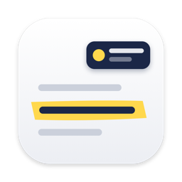
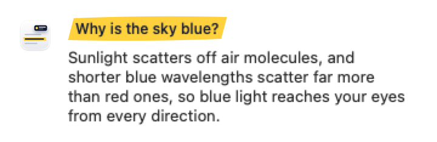
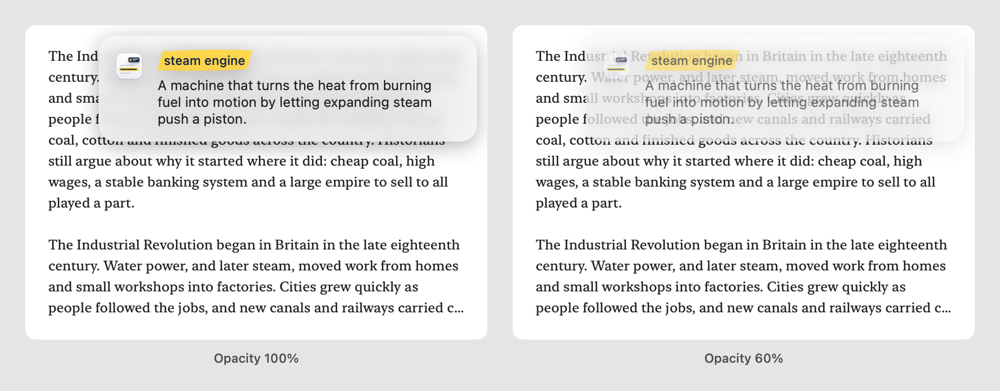
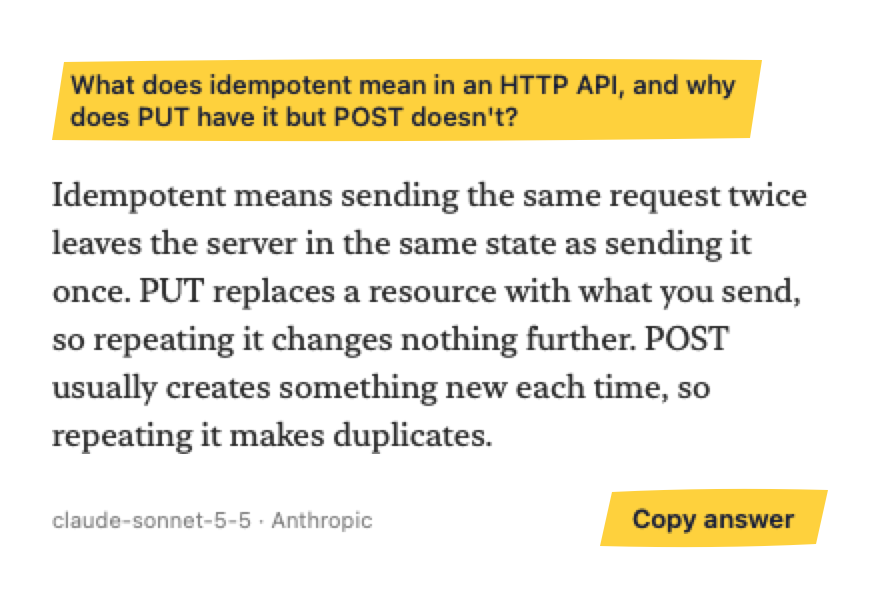
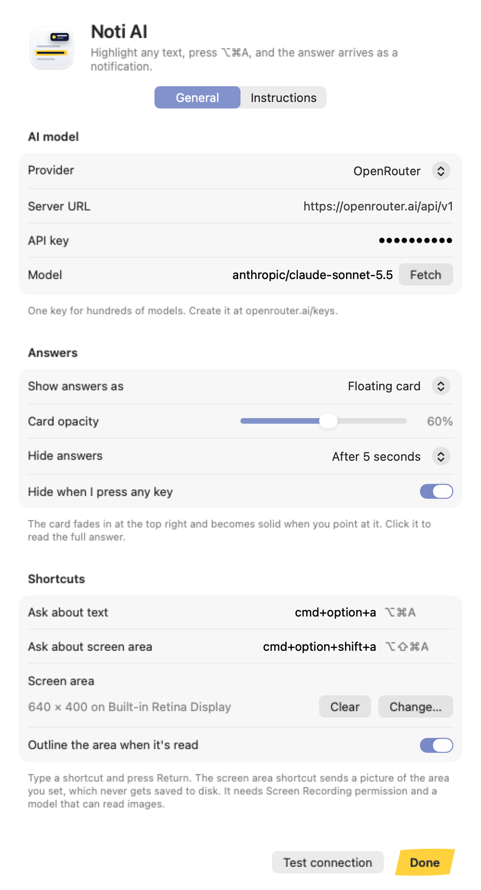

<p align="center">
  
</p>

<h1 align="center">Noti AI</h1>

<p align="center">
  Highlight text anywhere on your Mac, press <kbd>⌥</kbd> <kbd>⌘</kbd> <kbd>A</kbd>, and get the answer as a notification.
</p>

<p align="center">
  <a href="https://github.com/szeyu/noti-ai/releases/latest/download/NotiAI.dmg"></a>
</p>

<p align="center">
  <a href="https://github.com/szeyu/noti-ai/releases/latest"></a>
  
  
  <a href="LICENSE"></a>
</p>

<p align="center">
  
</p>

Noti AI sits in your menu bar. Select a word, an error message, a sentence in another language or a question, press the shortcut, and keep working. A few seconds later the answer shows up in the corner of your screen, so you never leave the app you're in.

## Features

| Feature | What it does |
|---|---|
| Any app | Works in browsers, PDFs, chat apps, code editors and Terminal. If you can select the text, you can ask about it. |
| Short answers | Explains, translates, defines or fact-checks in a few lines. Click an answer to read all of it. |
| Choice of model | Claude, OpenAI, OpenRouter, or a model on your own Mac through Ollama or LM Studio. |
| Notification or card | Shows answers as standard macOS notifications or as a floating card whose opacity you set. |
| Screen area | Save a part of your screen once, then press <kbd>⌥</kbd> <kbd>⇧</kbd> <kbd>⌘</kbd> <kbd>A</kbd> to ask about whatever it shows. Handy for images, charts, subtitles and apps that won't let you copy text. |
| Your own instructions | Tell the AI how to answer: always in Chinese, beginner-friendly, translation only, or anything else. |
| Auto-hide | Answers disappear after a few seconds or when you start typing. Your clipboard keeps what you copied. |
| Privacy | Sends text or a picture of your screen area only when you press a shortcut, and only to your chosen provider. The app has no account or analytics. |

## How answers look

Pick one in **Settings › General › Answers**.

**macOS notification.** A regular notification banner, like any other app's. It hides itself after a few seconds, and clicking it opens the full answer.

**Floating card.** Noti AI's own card in the top-right corner. Set its opacity anywhere from solid to barely there. It becomes solid while you point at it.

<p align="center">
  
</p>

Either way, clicking an answer opens it in full:

<p align="center">
  
</p>

## Ask about part of the screen

Some things can't be highlighted: text inside an image, a chart, a video's subtitles, a game, a remote desktop. For those, save an area of the screen once:

1. Menu bar icon › **Set screen area…**, or **Set area…** in Settings.
2. Drag a rectangle over the part of the screen you want. <kbd>Esc</kbd> cancels.
3. Press <kbd>⌥</kbd> <kbd>⇧</kbd> <kbd>⌘</kbd> <kbd>A</kbd> whenever you want to ask about what's in it.

The area flashes yellow so you can see what was sent. To keep it discreet, turn off **Outline the area when it's read** in Settings. The picture stays in memory, goes to your provider, and is never saved to disk. Your instructions apply to it as well.

This needs macOS 14 or later, **Screen Recording** permission, and a model that can read images. Claude and current OpenAI models can. With Ollama or LM Studio, pick a vision model such as Qwen-VL or LLaVA.

## Install

1. [Download NotiAI.dmg](https://github.com/szeyu/noti-ai/releases/latest/download/NotiAI.dmg), open it, and drag **Noti AI** into **Applications**.
2. Open Noti AI. macOS says it can't verify the developer, because Apple hasn't notarized the app. Go to **System Settings › Privacy & Security** and click **Open Anyway**. You only do this once.
3. In the Settings window that opens, pick a provider and paste your API key.
4. Turn on **Noti AI** in **System Settings › Privacy & Security › Accessibility**. This is how it reads the text you've highlighted.
5. Click **Allow** when macOS asks about notifications.
6. If you use the screen area shortcut, turn on **Noti AI** in **System Settings › Privacy & Security › Screen & System Audio Recording**, then quit and reopen Noti AI.

Then highlight some text and press <kbd>⌥</kbd> <kbd>⌘</kbd> <kbd>A</kbd>.

> After you update to a new version, you may need to switch Accessibility and Screen Recording off and on again for Noti AI.

## Providers

| Provider | API key | Notes |
|---|---|---|
| Anthropic (Claude) | [platform.claude.com](https://platform.claude.com/settings/keys) | The default. Choose Quick, Balanced or Thorough thinking. |
| OpenAI | [platform.openai.com](https://platform.openai.com/api-keys) | |
| OpenRouter | [openrouter.ai/keys](https://openrouter.ai/keys) | One key for models from many companies. |
| Ollama | Not needed | Runs on your Mac. Start Ollama and pull a model first. |
| LM Studio | Not needed | Runs on your Mac. Load a model and start the local server first. |
| Custom | Optional | Any server with an OpenAI-style `/chat/completions` endpoint. |

Click **Fetch** next to the model field to list the models a provider offers. Each provider remembers its own key and model, so switching back and forth doesn't lose anything.

To change how the AI answers, open the **Instructions** tab in Settings and write your own. **Reset to default** brings back the original instructions.

<p align="center">
  
</p>

## Everyday use

| To | Do this |
|---|---|
| Ask about text | Highlight it and press <kbd>⌥</kbd> <kbd>⌘</kbd> <kbd>A</kbd> |
| Ask about the screen area | Press <kbd>⌥</kbd> <kbd>⇧</kbd> <kbd>⌘</kbd> <kbd>A</kbd> |
| Move the screen area | Menu bar icon › **Change screen area…** |
| Read the whole answer | Click the notification or card. <kbd>Esc</kbd> closes the window. |
| Copy the answer | **Copy answer** on the notification or in the window |
| See the last answer again | Menu bar icon › **Show last answer** |
| Change model, look or shortcuts | Menu bar icon › **Settings…**, or open Noti AI again from Applications |

Settings save as you change them.

## Privacy

Noti AI sends the text you highlight, or a picture of your screen area, to the provider you chose, and only when you press a shortcut. Screen area pictures are kept in memory and never saved to disk. With Ollama or LM Studio, nothing leaves your Mac. API keys are stored in `~/.config/noti-ai/config.json`, which only your user account can read. The app has no servers or analytics of its own.

## Build from source

You need Apple's command-line tools (`xcode-select --install`); full Xcode isn't required.

```sh
git clone https://github.com/szeyu/noti-ai.git && cd noti-ai
./build.sh          # build, install to ~/Applications, and launch
./build.sh dmg      # build build/NotiAI.dmg
./build.sh app      # build build/NotiAI.app only
```

If you rebuild often, create a code-signing certificate named **Noti AI Local Signing** in Keychain Access (**Certificate Assistant › Create a Certificate…**, type **Code Signing**). `build.sh` uses it automatically, and you won't have to turn Accessibility back on after every build.

To publish a version, push a tag (`git tag v0.3.0 && git push origin v0.3.0`). GitHub Actions builds the DMG and attaches it to a new release.

<details>
<summary>Project layout and developer tools</summary>

```
Sources/NotiAI/
  App/      entry point, menu bar, the highlight-to-answer flow
  AI/       provider presets, Anthropic and OpenAI-compatible clients
  System/   settings file, shortcuts, reading the selection, screen capture, notifications
  UI/       theme, Settings, answer window, floating card, screen area picker
Assets/     make-icon.swift draws the app icon
```

```sh
APP=~/Applications/NotiAI.app/Contents/MacOS/NotiAI
$APP --ask "what is a monad?"   # ask the configured model from the terminal
$APP --ask-image shot.png      # send an image the way the screen area shortcut does
$APP --check-config            # show the loaded settings and available models
$APP --snapshot ./shots        # render the windows to PNG in light and dark mode
```

Set `NOTI_AI_CONFIG=/path/to/config.json` to try another configuration without touching yours.

</details>

## License

[MIT](LICENSE)
